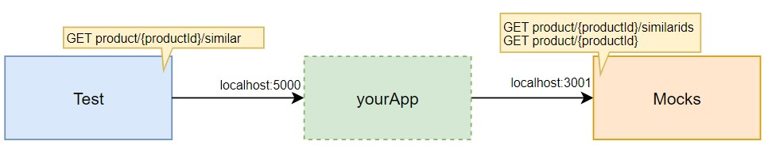

# Backend dev technical test
We want to offer a new feature to our customers showing similar products to the one they are currently seeing. To do this we agreed with our front-end applications to create a new REST API operation that will provide them the product detail of the similar products for a given one. [Here](./similarProducts.yaml) is the contract we agreed.

We already have an endpoint that provides the product Ids similar for a given one. We also have another endpoint that returns the product detail by product Id. [Here](./existingApis.yaml) is the documentation of the existing APIs.

**Create a Spring boot application that exposes the agreed REST API on port 5000.**



Note that _Test_ and _Mocks_ components are given, you must only implement _yourApp_.

## Testing and Self-evaluation
You can run the same test we will put through your application. You just need to have docker installed.

First of all, you may need to enable file sharing for the `shared` folder on your docker dashboard -> settings -> resources -> file sharing.

Then you can start the mocks and other needed infrastructure with the following command.
```
docker-compose up -d simulado influxdb grafana
```
Check that mocks are working with a sample request to [http://localhost:3001/product/1/similarids](http://localhost:3001/product/1/similarids).

To execute the test run:
```
docker-compose run --rm k6 run scripts/test.js
```
Browse [http://localhost:3000/d/Le2Ku9NMk/k6-performance-test](http://localhost:3000/d/Le2Ku9NMk/k6-performance-test) to view the results.

## Evaluation
The following topics will be considered:
- Code clarity and maintainability
- Performance
- Resilience

## Implemented solution

Java 21, Spring Boot 4.1.2 and Spring WebFlux. The application exposes
`GET /product/{productId}/similar` on port **5000**, following `similarProducts.yaml`.
The provided contracts, mocks, load test and infrastructure are unchanged.

### Run locally

Install JDK 21 and set `JAVA_HOME` if needed. Maven is downloaded automatically by
the committed wrapper on its first run; no global Maven installation is required.

```sh
./mvnw verify
docker compose up -d simulado
./mvnw spring-boot:run
```

In another terminal:

```sh
curl -i http://localhost:5000/product/1/similar
```

The response contains products `2`, `3` and `4`, in that order, including the
unavailable product `3`. Availability is returned as data, not used as a filter.
The application can also be run with `java -jar target/similar-products-1.0.0.jar`.

On macOS, AirPlay Receiver may already occupy port 5000. Free that port for the
official test, or use `SERVER_PORT=15000 ./mvnw spring-boot:run` for local development
and send requests to port 15000.

### Run everything in Docker

An optional overlay adds the application without changing the supplied Compose file:

```sh
docker compose -f docker-compose.yaml -f compose.app.yaml up -d --build app
```

The image runs as a non-root user. Its build runs the same automated tests.
Do not run the local application and the container simultaneously on port 5000.

### Behaviour and resilience decisions

1. Fetch the ordered list of similar IDs. Both the string IDs in the contract and
   the numeric IDs in the supplied mocks are accepted. Repeated IDs are fetched once.
2. Fetch details concurrently with `flatMapSequential`, preserving similarity order
   even when faster requests finish first. Return unique product IDs.
3. If a detail returns 404, an HTTP error, malformed data, a connection failure or
   exceeds the request deadline, omit that product and retain the other results.
   An empty list, or a list whose details all fail, returns `200 []`.
4. A 404 from the similar-ID endpoint returns 404. Failure or invalid data at that
   endpoint returns 502; a timeout returns 504. These infrastructure errors use
   `application/problem+json`. The 502/504 responses supplement the business contract:
   a catalog outage must not be presented as an unknown product or a successful empty list.

The fallback policy for failed details is an explicit design choice because the
contract does not specify it. Logs identify omitted products. There are no retries
that amplify an outage, no blocking calls on request threads, and no cache that can
serve stale availability or prices. Prices use `BigDecimal`.

Each catalog call has one end-to-end deadline, including connection acquisition and
body decoding. A second competing read timer is deliberately avoided.
The default **6 seconds** allows the supplied 5-second response while excluding the
50-second response. The HTTP connection pool and its wait queue are bounded globally;
detail concurrency is bounded per incoming request. The server requests a connection
backlog of 1024; the operating system may impose a lower limit. For larger lists,
work runs in batches, so the total request duration can exceed one catalog-call timeout.

Idle catalog connections expire after **4 seconds**, before the supplied Node
server's 5-second keep-alive timeout. The pool also evicts idle connections in the
background. This prevents reusing sockets while the catalog is closing them during
gaps between requests, without retrying failed calls.

Configuration is externalized:

| Environment variable | Default | Purpose |
| --- | --- | --- |
| `SERVER_PORT` | `5000` | Application port |
| `CATALOG_BASE_URL` | `http://localhost:3001` | Existing APIs; `http://simulado:80` in Compose |
| `CATALOG_CONNECT_TIMEOUT` | `1s` | Connection and pool-acquisition timeout |
| `CATALOG_REQUEST_TIMEOUT` | `6s` | Deadline for each catalog request |
| `CATALOG_MAX_IDLE_TIME` | `4s` | Maximum idle pool time; keep below the catalog's keep-alive timeout |
| `CATALOG_MAX_CONCURRENCY` | `16` | Concurrent detail requests per incoming request |
| `CATALOG_MAX_CONNECTIONS` | `1000` | Global catalog connection limit |
| `CATALOG_PENDING_ACQUIRE_MAX_COUNT` | `1000` | Maximum queued connection acquisitions |

### Verification

```sh
./mvnw verify
```

Tests start the real Spring Boot HTTP server and a local HTTP catalog stub, so they
need neither Docker nor external services. They cover JSON shape and prices,
numeric/string IDs, ordering, concurrent fetching and its limit, duplicates, empty
lists, unavailable products, failed/missing/malformed details, timeouts and upstream
error mapping. Tests also check all five original fixtures, decimal precision,
oversized responses and 200 concurrent requests with complete, ordered results.
The concurrency test ramps TCP connections while retaining all 200 requests in
flight; it does not validate an instantaneous 200-connection burst.

GitHub Actions is configured to run the Java 21 tests, build the Docker image,
check the container against the supplied mocks, and execute the original k6 script.
Test reports and container/load logs are uploaded as workflow artifacts. Runs
and downloadable reports are available in the repository's Actions tab.

With the supplied mocks, the expected results are:

| Request | Returned product IDs | Approximate catalog wait, without saturation |
| --- | --- | --- |
| `/product/1/similar` | `2, 3, 4` | 100 ms |
| `/product/2/similar` | `3, 100, 1000` | 5 s |
| `/product/3/similar` | `100, 1000` | 6 s; `10000` times out |
| `/product/4/similar` | `1, 2` | Immediate; detail `5` is missing |
| `/product/5/similar` | `1, 2` | Immediate; detail `6` fails |

The supplied benchmark can be run unchanged against either deployment:

```sh
docker compose up -d simulado influxdb grafana
docker compose run --rm k6 run scripts/test.js
```

Results are available at <http://localhost:3000/d/Le2Ku9NMk/k6-performance-test>.
The supplied k6 script records load metrics but defines no correctness assertions
or pass/fail thresholds; the automated tests verify the response behaviour.

A supplemental k6 script checks status codes, JSON field types, the five expected
ordered lists, and an unknown product. It fails if any assertion fails:

```sh
# Requires a running application and the supplied mocks; tested with k6 2.3.0.
k6 run -e BASE_URL=http://localhost:5000 tests/k6/contract.js
```

### Docker/Linux validation (2026-11-10)

The final implementation was built and tested with its Dockerfile and the original
Compose mocks on Alpine Linux (Lima VM, 4 vCPUs, 3 GiB RAM, Docker 29.9.3).
The application ran natively on ARM64 as the non-root `app` user, on port 5000.
The original Intel `simulado` and k6 0.28.0 images ran under QEMU user emulation.

- **35 automated tests passed inside the Docker build**, including the regression
  test that proves idle connections are replaced before reuse. They also pass locally.
- **16 contract assertions passed against the Docker application and original mocks**,
  including all five ordered results and the unknown-product 404. This supplemental
  check used native macOS k6 2.3.0 through the VM's forwarded port.
- **The original Docker k6 0.28.0 script completed with 200 VUs: 3,108 responses,
  all HTTP 200, zero unexpected responses and zero recorded transport errors.**
  The application logs contained no connection-reset or premature-close errors.
- Observed overall response times were median 2.06 s, p95 6.55 s and maximum 7.37 s.
  These include emulation overhead in both supplied images and are not a native
  production capacity measurement. The supplied script defines no latency threshold.

The first unsuspended Docker load run exposed 39 HTTP 502 responses out of 3,716
requests. Idle pooled sockets were being reused as the supplied Node server closed
its keep-alive connections. Setting a 4-second maximum idle time and background
pool eviction eliminated those failures in the final run, without enabling retries.
A separate run interrupted by host suspension and a 497-second guest-clock adjustment
was excluded; the accepted run kept the host awake.

The workload, mocks and contracts were not changed. For capture, `K6_OUT` was changed
from InfluxDB to JSON and `--summary-export` was added. The original script deliberately
interrupts iterations at scenario boundaries; those are not failed HTTP responses.
The default application port remains 5000. The Mac accesses it through forwarded
port 15000 because AirPlay occupies its own port 5000.

Persistent evidence, including image digests, a source fingerprint, counts and
per-scenario timings, is in
[`verification/docker-linux-2026-11-10.json`](./verification/docker-linux-2026-11-10.json).
Raw results and Docker test reports are in `target/docker-k6-results.json`,
`target/docker-k6-summary.json`, `target/docker-k6-analysis.json`,
`target/docker-app.log`, `target/docker-contract-summary.json` and
`target/docker-surefire/` (ignored by Git and removed by `mvn clean`).

To record and validate the same workload on a Docker/Linux host, with the
application and mocks running:

```sh
mkdir -p target
docker compose -f docker-compose.yaml -f compose.app.yaml run --name supplied-k6 \
  -e K6_OUT=json=/tmp/k6-results.json k6 run --summary-export /tmp/k6-summary.json scripts/test.js
docker cp supplied-k6:/tmp/k6-results.json target/supplied-k6-results.json
docker cp supplied-k6:/tmp/k6-summary.json target/supplied-k6-summary.json
python3 tests/k6/summarize.py target/supplied-k6-results.json --output target/supplied-k6-analysis.json
docker rm supplied-k6
```

The analyzer fails if any recorded request returns a status other than 200. GitHub
Actions now uses this check, so the supplied script's zero exit status alone cannot
hide HTTP failures. Workflow execution results are recorded in the repository's
Actions tab separately from the local validation report below.

An earlier native macOS run used a different k6 version and a Python mock server;
its initial connection resets were not a clean performance result. The original
Docker/Linux setup above is now validated separately, including its instantaneous
200-VU start. Timing numbers from those different environments are not comparable.
